# PetClinic Load Testing

[](https://github.com/denis-melnik-qa/petclinic-load-testing/actions/workflows/loadtest.yml)

A single-machine load-testing lab: Spring PetClinic + PostgreSQL in Docker Compose, tested with JMeter and monitored with Prometheus and Grafana. It contains a step-load capacity test, a 2-hour soak test, a before/after index experiment and a GitHub Actions smoke test.

## Goal

To show a complete load-testing workflow: acceptance criteria defined before the run, warm-up and data cleanup before every test, a control request, and a before/after comparison with the evidence kept in the repository. The numbers illustrate the method; they are not absolute performance figures (see Limitations and caveats below).

<details>
<summary><h2>Test bench</h2></summary>

```
JMeter (on the host) --HTTP--> app :8080 --JDBC--> postgres
                                 |                    |
                      /actuator/prometheus     postgres-exporter
                                 \                    /
                                  Prometheus :9090 --> Grafana :3000
```

| Service | Image / source | Limits |
|---|---|---|
| app | Spring PetClinic, built from `app/Dockerfile` (Java 21, profile `postgres`, Micrometer Prometheus registry) | `cpus: 2`, 768 MB, `-Xmx400m` |
| postgres | `postgres:16`, `pg_stat_statements` preloaded | 384 MB |
| postgres-exporter | `prometheuscommunity/postgres-exporter` | 128 MB |
| prometheus | `prom/prometheus` | 256 MB |
| grafana | `grafana/grafana`, alerting disabled | 512 MB (set in `docker-compose.override.yml`) |

`docker compose` applies `docker-compose.override.yml` automatically.

**Reproducibility.** PetClinic is cloned from the default branch (`git clone --depth 1`) and is **not pinned**; the local image behind the results was built on 2026-11-12. Prometheus, Grafana and the exporter images are untagged. A rebuild may produce different code and different numbers.

**Data** (`db/generate_data.sql`): about 100,000 owners, 100,000 pets, 200,000 visits, 909 distinct last names. The distribution of pets per owner was not analysed.

### Repository layout

| Path | Purpose |
|---|---|
| `docker-compose.yml`, `docker-compose.override.yml`, `app/Dockerfile`, `prometheus/prometheus.yml` | the stand |
| `grafana/dashboards/PetClinic.json` | Grafana dashboard (imported manually) |
| `db/generate_data.sql` | generates the dataset (run once) |
| `db/indexes.sql` | index for search by last name (see the index experiment) |
| `db/cleanup.sh`, `db/cleanup_test_data.sql` | remove data created by the tests |
| `jmeter/petclinic.jmx` | base scenario; parameters `-Jthreads -Jrampup -Jduration -Jthink -Jhost -Jport` |
| `jmeter/petclinic_capacity.jmx` | step-load scenario (Ultimate Thread Group) |
| `jmeter/data/*.csv` | test data for JMeter |
| `jmeter/warmup.sh` | warm-up: 150 rounds of 3 requests |
| `jmeter/check_results.sh` | p95 and error-rate check (used in CI) |
| `jmeter/summarize_windows.sh` | table per load step |
| `jmeter/summarize_labels.sh`, `jmeter/summarize_norm.sh` | per-request statistics |
| `jmeter/record_stats.sh` | `docker stats` to CSV every 30 s |
| `jmeter/db_snapshot.sh`, `jmeter/pg_diagnostics.sh` | table sizes, PostgreSQL counters, top statements |
| `.github/workflows/loadtest.yml` | CI smoke test |
| `docs/` | screenshots and text summaries of the runs |

`results/` and `*.jtl` are git-ignored.

</details>
<details>
<summary><h2>How to run</h2></summary>

### Prerequisites

- Docker Desktop (WSL2). The results come from a 6 GB machine with WSL limited to `memory=3GB`, `processors=2`, `swap=6GB`.
- Bash with `awk` and `curl` (Git Bash on Windows).
- JMeter 5.6.3. `petclinic_capacity.jmx` also needs the **Custom Thread Groups** plugin (Ultimate Thread Group).

### Start the stand

```bash
docker compose up -d --build
docker compose exec -T postgres psql -U petclinic -d petclinic -v ON_ERROR_STOP=1 < db/generate_data.sql
docker compose exec postgres psql -U petclinic -d petclinic -c "CREATE EXTENSION IF NOT EXISTS pg_stat_statements;"
```

The extension is only needed for the `pg_stat_statements` queries (it is not created by any script in `db/`). `db/indexes.sql` is **not** applied by default; apply it only for the "with index" variant:

```bash
docker compose exec -T postgres psql -U petclinic -d petclinic -v ON_ERROR_STOP=1 < db/indexes.sql
```

- App: http://localhost:8080
- Prometheus: http://localhost:9090
- Grafana: http://localhost:3000 (admin / admin). Dashboards are not provisioned: Dashboards > New > Import > upload `grafana/dashboards/PetClinic.json`. Only the Prometheus data source is provisioned; the import on a clean install has not been re-verified.

Stop with `docker compose stop`. Do not use `down` or `-v`: Prometheus has no volume, so `down` erases the metric history, and `-v` deletes the database and Grafana data.

### Before every test

```bash
docker compose start
db/cleanup.sh
jmeter/warmup.sh && sleep 60
```

The first requests after a cold start take 13-14 s, so warm-up is required and is not part of the analysis.

### Run the tests

```bash
export HEAP="-Xms256m -Xmx512m"
JMETER=/c/tools/apache-jmeter-5.6.3/bin/jmeter.bat   # adjust to your installation
mkdir -p results

# capacity test (about 35 min)
$JMETER -n -t jmeter/petclinic_capacity.jmx -Jthink=100 -l results/capacity.jtl
jmeter/summarize_windows.sh results/capacity.jtl 210 30

# soak test (2 hours)
$JMETER -n -t jmeter/petclinic.jmx -l results/soak.jtl \
  -Jthreads=56 -Jrampup=60 -Jduration=7200 -Jthink=100
jmeter/summarize_labels.sh results/soak.jtl 0 1800        # first 30 minutes
```

Optional recorders while a test runs: `jmeter/record_stats.sh out.csv`, `jmeter/pg_diagnostics.sh <label> <dir> <interval_s>`.

</details>
<details>
<summary><h2>Methodology</h2></summary>

- **Acceptance criteria:** p95 response time <= 1000 ms and errors < 1%.
- **Maximum load** is the last step that meets the criteria; the next step is the breaking point. The maximum is confirmed with a separate 10-minute run.
- **Load model:** closed (fixed number of virtual users), 100 ms think time, 5 requests per iteration: search by last name (`GET /owners`), view owner (`GET /owners/{id}`), list vets (`GET /vets.html`), create owner (`POST /owners/new`), add visit (`POST .../visits/new`).
- **Before every test:** application warm-up and removal of data created by earlier tests (owners with last names starting with `LT`, visits with the descriptions `Test Visit` and `Load test visit`, then `ANALYZE`).
- **Control request:** `GET /vets.html` does not depend on the size of the `owners` table, so it separates a resource problem from the effect of data growth.
- **Metrics:** JMeter results for response times; Prometheus/Grafana for JVM, HikariCP and PostgreSQL; `docker stats` and `pg_stat_statements` for resources and queries.

</details>
<details><summary><h2>Capacity test (step load)</h2></summary>

Scenario `petclinic_capacity.jmx`: 10 steps from 10 to 100 users (+10 per step), each step 30 s ramp-up + 180 s hold, 100 ms think time. No text_pattern_ops index at that time (the plain `idx_owners_last_name` was present).

| Users | req/s | avg, ms | p95, ms | p99, ms | errors |
|------:|------:|--------:|--------:|--------:|-------:|
| 10    | 63.5  | 50      | 141     | 241     | 0%     |
| 20    | 114.4 | 68      | 175     | 261     | 0%     |
| 30    | 140.4 | 106     | 240     | 347     | 0%     |
| 40    | 153.1 | 154     | 391     | 568     | 0%     |
| 50    | 155.7 | 213     | 534     | 780     | 0%     |
| 60    | 157.3 | 274     | 720     | 1049    | 0%     |
| 70    | 154.6 | 345     | 952     | 1449    | 0%     |
| 80    | 146.3 | 440     | 1216    | 1879    | 0%     |
| 90    | 135.6 | 555     | 1459    | 2077    | 0%     |
| 100   | 132.1 | 650     | 1696    | 2517    | 0%     |

**Result:** the maximum load meeting the criteria is **70 users**; the first step that violates them is 80 users. Throughput peaks at 157 req/s around 60 users and then declines while response times grow because of queueing; there are no errors.

**Confirmation:** a separate 10-minute run at 70 users (60 s ramp-up): 167 req/s, avg 310 ms, p95 851 ms, p99 1304 ms, 0% errors (`docs/baseline-70users-summary.txt`). The slowest request is the search by last name (`GET /owners`): p95 1176 ms, above 1 s on its own, while the overall p95 is lower because the other requests are faster (`docs/baseline-70users-per-request.txt`).

**Observations**
- From about 40 users the application and the database together use about 180% CPU of the 2 cores available to Docker (Grafana observation, combined figure, not a JMeter metric). This points to CPU saturation of the whole host.
- JMeter counts about 157 req/s; the server sees roughly 1.4x more requests because of redirects after POST, which explains the higher request rate in Grafana.

<details>
<summary><code>Grafana screenshots: capacity test and 70-user confirmation run</code></summary>

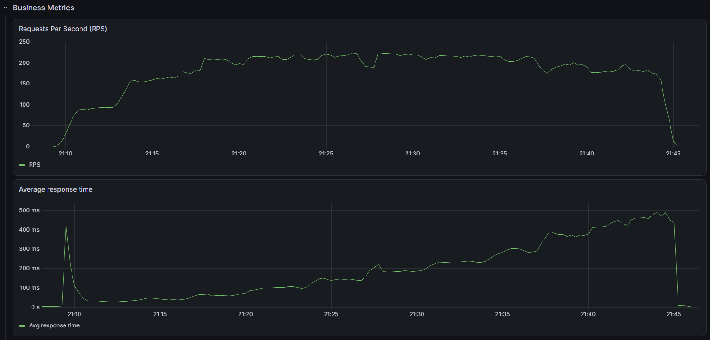
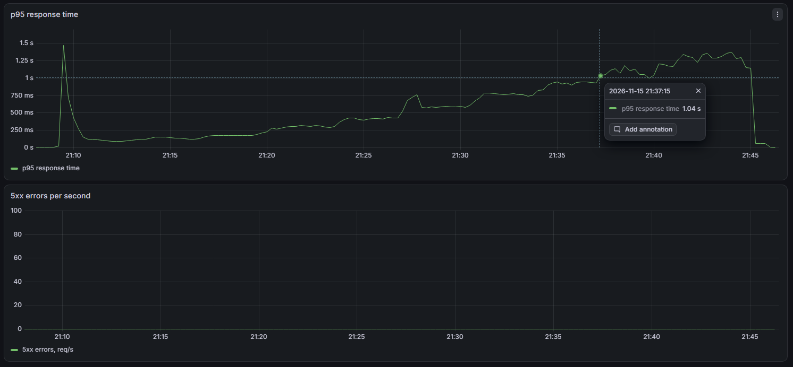
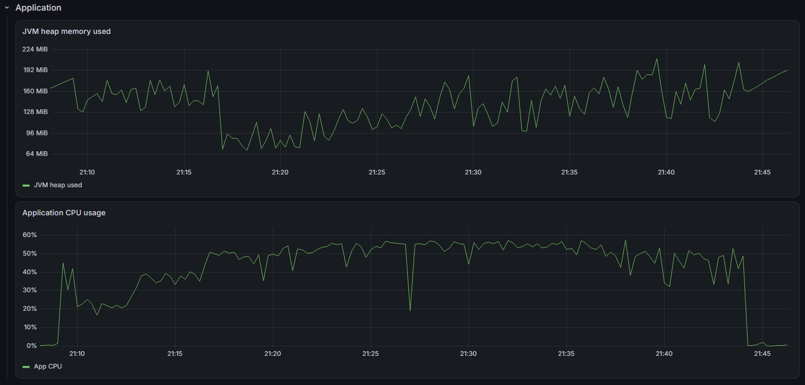
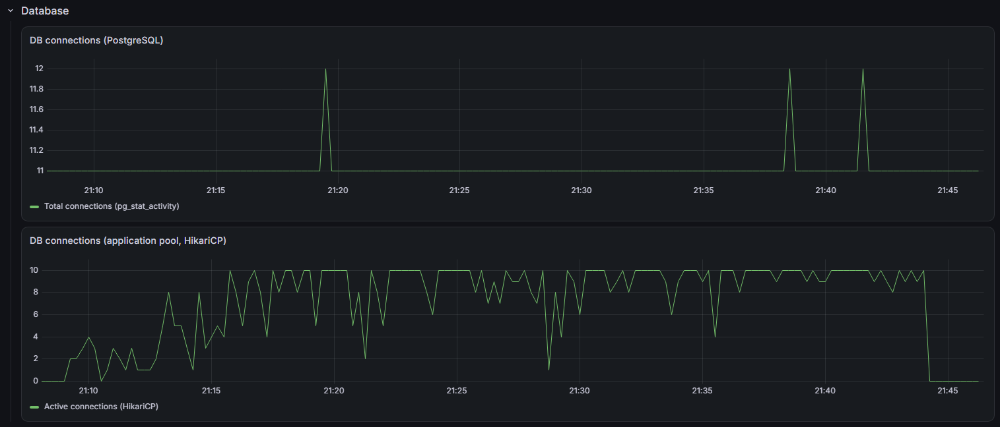
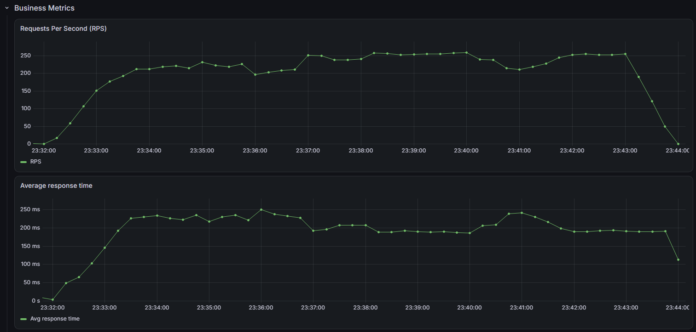

</details>
</details>
<details>
<summary><h2>Stability (soak) test</h2></summary>

**Goal:** check that response times stay steady and no resource leak appears under a constant load below the maximum.

**Load:** 56 users (80% of the 70-user maximum), 2 hours (7259 s in the JTL), 60 s ramp-up, 100 ms think time, base scenario `petclinic.jmx` (the same five requests as the capacity scenario). Test data was removed and the application warmed up before each run. Data was deliberately **not** cleaned during the run, so the database grew (owners: 100k to 316k in the first run).

**Acceptance criteria (defined before the run):**
1. Errors < 1%.
2. No container restarts or OOM kills.
3. Control request (`GET /vets.html`): p95 of the last 30 minutes within 15% of the first 30 minutes.
4. JVM heap minimums and the HikariCP `pending` metric do not grow over time.
5. Growth of data-dependent requests is reported, not a criterion.

**Results** (the second run has the index from `db/indexes.sql`, see the next section):

| # | Criterion | Without index | With index |
|---|---|---|---|
| 1 | Errors | 0 of 1,079,842; met | 0 of 1,513,703; met |
| 2 | Restarts / OOM | none: app `resets` = 0, container logs checked; met | none, same checks; met |
| 3 | `/vets.html` p95, first to last 30 min | 252 to 124 ms (no degradation); met | 169 to 165 ms; met |
| 4 | Heap minimum per 30-min window, windows 2-4 | 116 / 107 / 108 MiB; met | 134 / 130 / 126 MiB; met |
| 4 | HikariCP `pending`, mean per 30-min window | 11.7 / 13.9 / 20.3 / 26.3; **not met** | 11.0 / 14.6 / 14.8 / 14.9; plateau |
| 5 | `GET /owners` p95, first to last 30 min | 786 to 794 ms | 518 to 523 ms |
| 5 | `GET /owners/{id}` p95 | 301 to 526 ms | 216 to 221 ms |
| 5 | `POST` add visit p95 | 553 to 935 ms | 442 to 463 ms |

**Notes and observations**
- Criterion 3 says "within 15%"; the control request got faster, so there is no degradation (the deviation is in the favourable direction).
- Criterion 4 did not specify an aggregation. The per-window maximum of `pending` sits at the pool limit (43-46 with a pool of 10), so the **mean per 30-minute window was chosen after the run**. Mean connection acquire time grew from 25 ms to 94 ms without the index and stayed at 17-20 ms with it. Window 1 of the heap is JVM start-up and is not compared.
- Restart checks: PostgreSQL has no restart metric in Prometheus; it was checked through container logs (keyword search), not through a metric.
- Without the index the system degraded steadily: throughput fell from about 167 to 123 req/s at constant load. The cause is analysed in the index experiment.

- Without the index, throughput stepped down at about 52 minutes (20:23 local time): requests per second fell from roughly 235 to 205. CPU of app + database stayed near 180% of 2 cores, but the database share grew (app about 106% to 91%, postgres about 71% to 89%, averages from `docker stats` samples) and the number of PostgreSQL connections started to fluctuate (11 to 18, before it was constant at 11). This matches the count query switching to a parallel sequential scan: at the current table size (about 403k owners) `EXPLAIN` without the index shows `Gather` with 2 planned workers. The switch itself was not confirmed.
- Each run had one short stall (about 97 minutes in the first run, about 12 minutes in the second, approximate): roughly 50-130 requests took over 3 s, maximum 6-7 s, about one request per virtual user. GC pauses were at most 0.25 s, there was no restart, and checkpoints ran about every 5 minutes with `sync` of about 1 s or less, so none of these explains it. The cause was not identified.

<details>
<summary>Grafana screenshots: soak without index</summary>

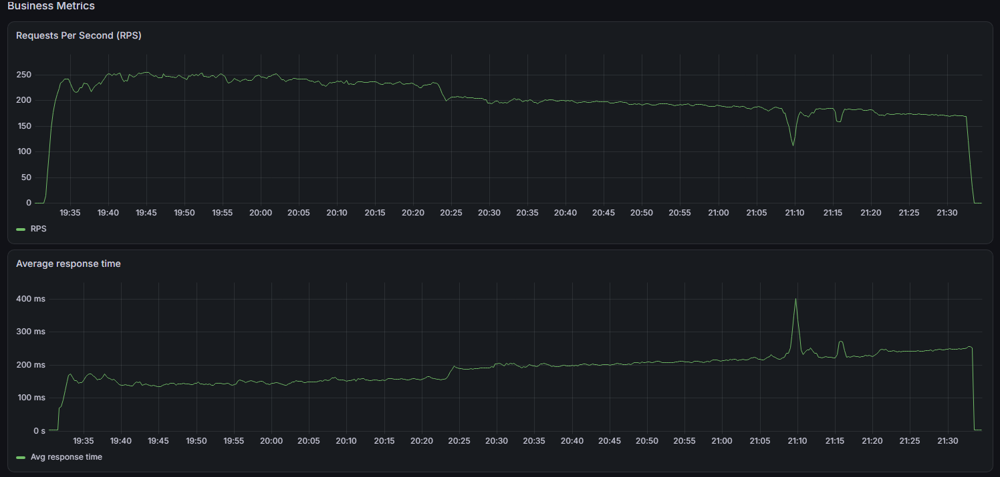
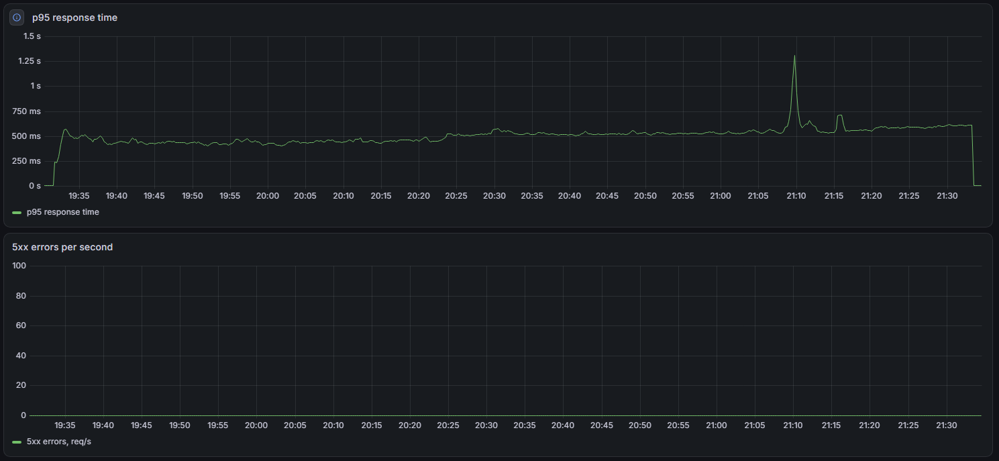
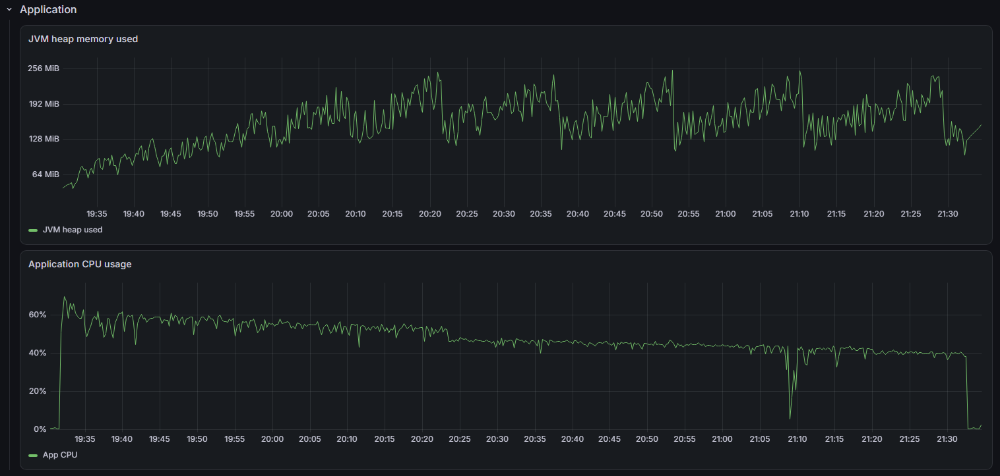
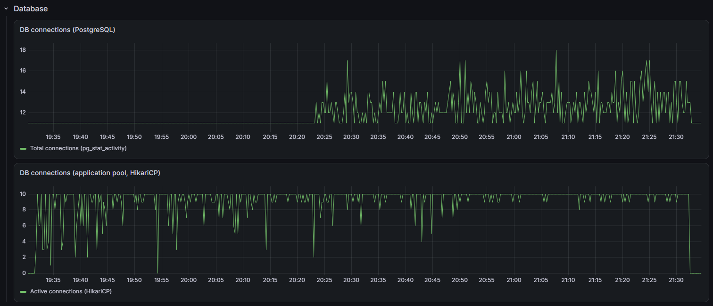

</details>
</details>
<details>
<summary><h2>Index experiment (search by last name)</h2></summary>

This was run as an experiment. The missing prefix index is a property of this lab setup, not a defect in PetClinic.

**Why:** the soak test showed steady degradation (throughput down by about 27%, from 167 to 123 req/s, at constant load). `pg_stat_statements` showed that one query, the count query of the owner search (`last_name LIKE 'prefix%'`), took about 90-95% of the database time and its cost grew with the table (mean 66 ms over the run; about 2,100 buffer reads per call vs about 1,000 at the start). Cache hit ratio was about 100%, checkpoints were regular and autovacuum kept up, so memory and disk were ruled out.

**Plan before:** `Parallel Seq Scan on owners` (`Rows Removed by Filter: 105290`, `Buffers: shared hit=3252`), **Execution Time: 22.921 ms**.
**Plan after:** `Index Scan using idx_owners_last_name_pattern` (`Index Cond: ((last_name ~>=~ 'Lanris') AND (last_name ~<~ 'Lanrit'))`, `Buffers: shared hit=103 read=3`), **Execution Time: 0.363 ms**. Raw plans: `docs/explain-before-after.txt`.

**Change:**
```sql
CREATE INDEX idx_owners_last_name_pattern ON owners (last_name text_pattern_ops);
```
A plain btree index `idx_owners_last_name` already existed; the planner still chose a sequential scan, because `LIKE 'prefix%'` needs `text_pattern_ops` unless the collation is "C". See `db/indexes.sql`.

**Comparison:** two 2-hour soak runs at 56 users on the same starting data (about 100k owners / 200k visits after `db/cleanup.sh`), cleaned and warmed up before each, `pg_stat_statements` reset before each, browser closed (see `docs/index-experiment.txt`). The "after" run ended with a larger table (403k owners vs 316k) and still did better.

| Parameter | Without index | With index |
|---|---:|---:|
| req/s, first 10-min window | 167.4 | 206.5 |
| req/s, last 10-min window | 122.8 | 206.8 |
| avg, first to last, ms | 230 to 352 | 167 to 166 |
| p95, first to last, ms | 606 to 789 | 427 to 433 |
| p99, first to last, ms | 879 to 1154 | 747 to 607 |
| `GET /owners` p95, ms (first to last) | 783 to 792 | 520 to 523 |
| count query, mean ms | 66.44 | 0.14 |
| count query, total DB time | 14,217 s | 42.9 s |
| count query, buffers per call | about 2,138 | about 108 |

**Caveats:** one run per variant, and the run without the index went first, so the JMeter percentages are only a rough guide; the database-side numbers are the main evidence. `GET /owners` is still the slowest request (avg 247 ms in the indexed soak) although the database now spends about 0.14 ms on it. The remaining time is most likely spent in the application and in waiting for CPU on the shared machine (hypothesis, not verified). Both runs lasted 120 minutes, but the table grew differently during them. A shorter pair of 10-minute runs at 70 users is summarised in `docs/index-experiment_10min.txt`.

<details>
<summary>Grafana screenshots: soak with index</summary>

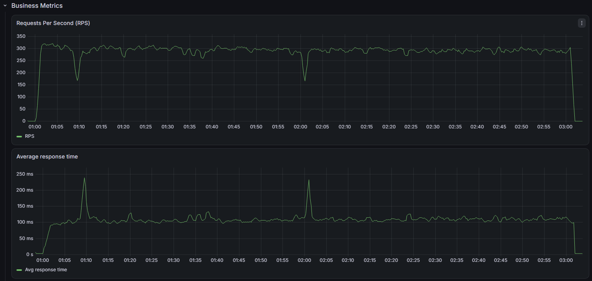
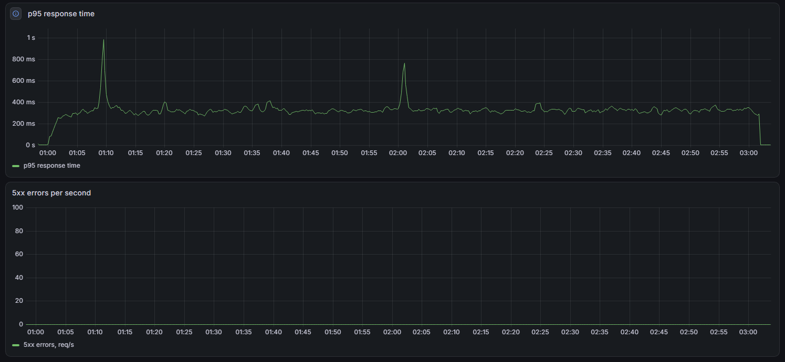
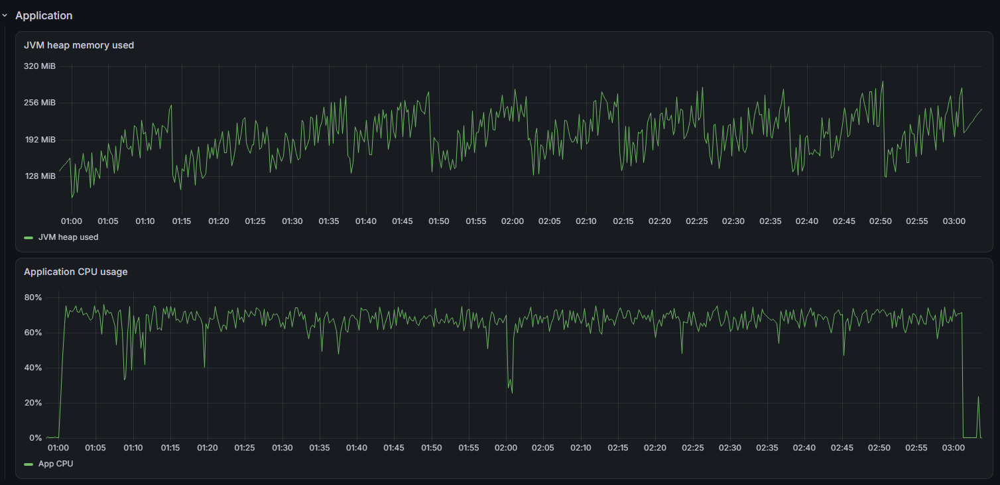
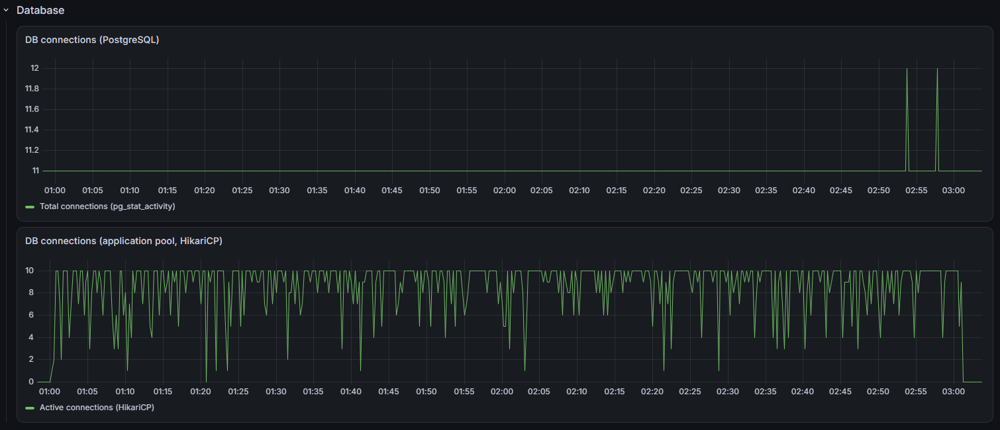

</details>
</details>
<details>
<summary><h2>CI (GitHub Actions)</h2></summary>

On every push to `main` (changes to `*.md` files are ignored), every pull request and on manual trigger, the workflow:

1. starts only the app and PostgreSQL with Docker Compose;
2. loads `db/generate_data.sql` and `db/indexes.sql` (the CI database **has** the index);
3. installs JMeter 5.6.3 and warms up the app;
4. runs `petclinic.jmx` as a smoke test: 30 users, 30 s ramp-up, 180 s total, 100 ms think time;
5. checks the criteria with `jmeter/check_results.sh` (p95 <= 1000 ms, errors < 1%, first 30 s excluded);
6. writes a per-request summary (`jmeter/summarize_norm.sh`) to the job summary and uploads `results/` as the `ci-results` artifact.

<!-- Uncomment after the screenshot is added:

-->

[Latest runs](https://github.com/denis-melnik-qa/petclinic-load-testing/actions/workflows/loadtest.yml)

**Scope.** The CI run is a smoke test. It catches breakages and gross slowdowns, but not small regressions: the load is limited by the think time (about 240-280 req/s), the runner is shared, and JMeter runs on the same machine as the application. Two runs gave p95 of 14 ms and 66 ms, so the spread between runs is large. Do not compare these numbers with the local capacity results. There is **no JMeter HTML report** in CI: generating it ran out of memory (`OutOfMemoryError`) and the cause was not investigated. Prometheus and Grafana are not started in CI.

</details>
<details>
<summary><h2>Limitations and caveats</h2></summary>

- Hardware: a 6 GB machine; the application, PostgreSQL, monitoring and JMeter share one host with 2 CPUs and 3 GB RAM for WSL. Absolute numbers do not represent production hardware; the project demonstrates the method.
- **Resource limits** (`cpus`, `mem_limit`, `-Xmx400m`) are deliberately small and were chosen to make the bottleneck reproducible on a small machine.
- **Grafana alerting is disabled** to save memory.
- Not pinned: PetClinic (default branch HEAD) and the monitoring images. The results come from an image built on 2026-11-12; CI builds the current HEAD.
- Single runs: one run per scenario and variant. No confidence intervals; the JMeter side of the index comparison is only a rough guide.
- Index state differs between tests: the capacity and confirmation runs had no `text_pattern_ops` index; the CI database has it.
- Data: generated, 909 distinct last names; the distribution of pets per owner was not checked.
- Unexplained: the one stall per soak run (see above); the exact moment and mechanism of the step at about 52 minutes (consistent with a parallel scan, not confirmed).
- **Criterion 4** (`pending` aggregation) was refined after the run.
- Plugin: `petclinic_capacity.jmx` requires the Ultimate Thread Group plugin.
- CI: smoke test only, no HTML report (see above).
- Think time: `petclinic_capacity.jmx` defaults to 500 ms; all results here were obtained with `-Jthink=100`.

</details>
